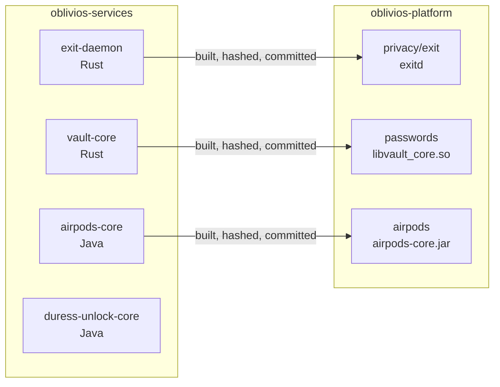

<p align="center">
  <a href="https://oblivios.org">
    <picture>
      <source media="(prefers-color-scheme: dark)" srcset="https://oblivios.org/brand/lockup-dark.svg">
      
    </picture>
  </a><br>
  <a href="https://oblivios.org">oblivios.org</a> · <a href="https://oblivios.dev">oblivios.dev</a>
</p>

<h1 align="center">oblivios-services</h1>

<p align="center">
  <strong>The platform-independent logic and native daemons behind ObliviOS features.</strong><br>
  Small Java and Rust modules with their own tests, kept apart from the Android patches in <code>oblivios-platform</code>.
</p>

<p align="center">
  
  
  
</p>

> **Stage: source only.** No build, image or update service is offered and no device is supported
> ([ADR-171](https://github.com/Beau4201/oblivios-docs/blob/main/docs/governance/decision-log.md)). Nothing here is Android enforcement on
> its own, and the repository contains no GrapheneOS or AOSP source.

## Modules

| Module | Language | What it holds | Ships as |
| --- | --- | --- | --- |
| [`exit-daemon`](exit-daemon/README.md) | Rust | `exitd`, the exit daemon of Compartments: a typed control protocol, per-app policy, DNS decisions and a Tor client for apps set to Tor, on top of a vendored and patched [Onionmasq](https://gitlab.torproject.org/tpo/core/onionmasq). | The prebuilt `exitd` in `oblivios-platform` |
| [`vault-core`](vault-core/README.md) | Rust | The core of the Passwords app: sealed vault file, key wrappers, domain index, checkup, export and import, and the JNI surface. | The prebuilt `libvault_core.so` in `oblivios-platform` |
| [`airpods-core`](airpods-core/README.md) | Java | The codec for the AirPods control messages, the validated settings and states, and the state machine that the platform integration drives. | The prebuilt `airpods-core.jar` in `oblivios-platform` |
| `duress-unlock-core` | Java | The logic of Duress Unlock, without dependencies. | Source only: no prebuilt of it is committed in `oblivios-platform` |



The arrows are a build step: a binary is built here from a recorded commit and committed in `oblivios-platform` with its source commit,
toolchain, build command and SHA-256. A record in `oblivios-platform` states each hash and a script compares the file with it.

## Build and test

**Java modules** (`duress-unlock-core`, `airpods-core`) use the Gradle wrapper of this repository and need a JDK:

```sh
./gradlew test
```

**Rust crates** (`exit-daemon`, `vault-core`) are built and checked on a build host with the AOSP Rust toolchain (1.93.1), never on a
workstation. Each crate has scripts that copy the tree to that host, run there and fail when no test ran:

| Task | `exit-daemon` | `vault-core` |
| --- | --- | --- |
| Host tests | `EXIT_BUILD_SSH=<user@host> tools/check-on-server.sh` | `VAULT_BUILD_SSH=<user@host> tools/check-on-server.sh` |
| Android binary | `tools/build-android.sh` (aarch64, checks the binary itself) | `tools/build-android.sh` |
| After a dependency change | `tools/update-lock.sh` | `tools/update-lock.sh` |

Every Rust build uses `--locked` and the committed `Cargo.lock`. The scripts read what the binary holds and not only the exit code of the
build, because a build once exited 0 with a file that contained no Tor code.

## Verify

- **Tests.** The last run of the `exit-daemon` host tests (2026-11-17) passed 344 tests. A mutation runner (`exit-daemon/tools/run-mutations.py`)
  applies single-line mutations and counts one as killed only when the tests ran and failed.
- **Reproducible binary.** The `exitd` committed in `oblivios-platform` was built twice into two separate target directories and both builds
  have the same SHA-256.
- **Licences and advisories.** `exit-daemon/tools/check-licences.sh` checks that every package of `Cargo.lock` can be used under the
  licence terms the project allows and keeps `exit-daemon/NOTICE` current. `exit-daemon/RISKS.md` assesses the advisories that OSV lists for the lock.
  `exit-daemon/tools/third-party-licences.py` writes the licence texts of the registry packages of a lock.
- **Bill of materials.** `oblivios-docs` holds a CycloneDX 1.6 and an SPDX 2.3 document for all four repositories, including every
  package of both `Cargo.lock` files.

## Invariants

These are the rules a change to this repository has to respect ([`CONTRIBUTING.md`](CONTRIBUTING.md)):

- No telemetry, analytics, crash reporting or phone-home behaviour of any kind.
- Data is minimised technical metadata: no message bodies, file contents, camera frames, microphone audio, contacts, clipboard content or
  location coordinates.
- No partial implementation is presented as done. What cannot be completed or verified is stated, with exactly what is missing.
- A new field, action, schema or capability needs an accepted decision in the decision log before the code.

## What is and is not claimed

- A host test proves the module, not the feature on a phone. The `exit-daemon` README lists its known gaps under
  "Known gaps before an image carries the daemon".
- The `exit-daemon` build of 2026-11-17 has not been run on a phone.
- The AirPods byte layouts come from the protocol notes of the LibrePods project (GPL-3.0); only the layouts, which are facts about a
  protocol, were taken, and no code or text was copied ([`airpods-core/README.md`](airpods-core/README.md)). The notes were taken with one
  model and firmware; others may differ.

## Security

Do not open a public issue for a vulnerability. See [`SECURITY.md`](SECURITY.md) for the contact, the PGP key and what to expect.

## Contributing

Issues can be opened where the host enables them. Pull requests are not accepted yet. [`CONTRIBUTING.md`](CONTRIBUTING.md) lists the
invariants and the commit style.

## Licence

Apache-2.0, see [`LICENSE`](LICENSE) and [`NOTICE`](NOTICE). `CONTRIBUTING.md` asks for an `SPDX-License-Identifier` line in every source file of the project. The vendored
Onionmasq crates keep their own licence (`MIT OR Apache-2.0`), recorded in `exit-daemon/SOURCE.md`.

The name ObliviOS and its logo are not licensed. ObliviOS is based on GrapheneOS; it is not affiliated with or endorsed by the GrapheneOS
project.
